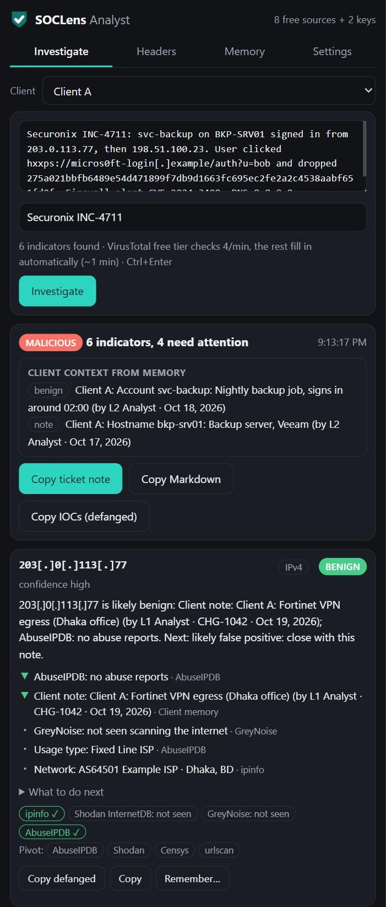
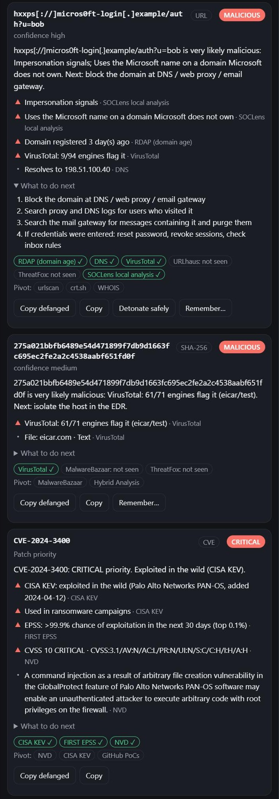
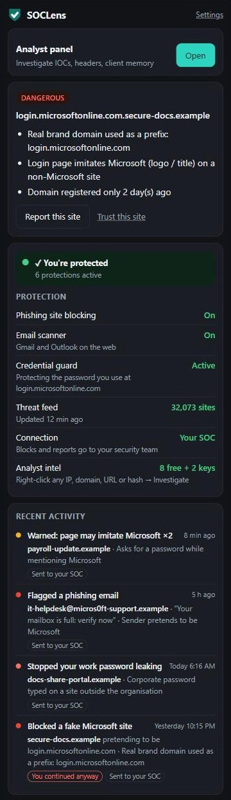
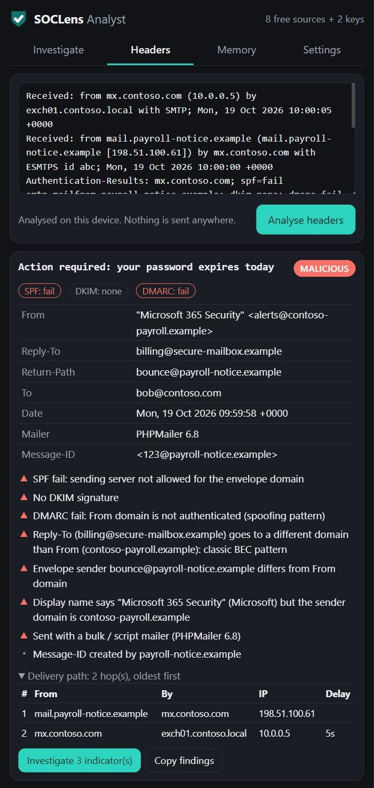
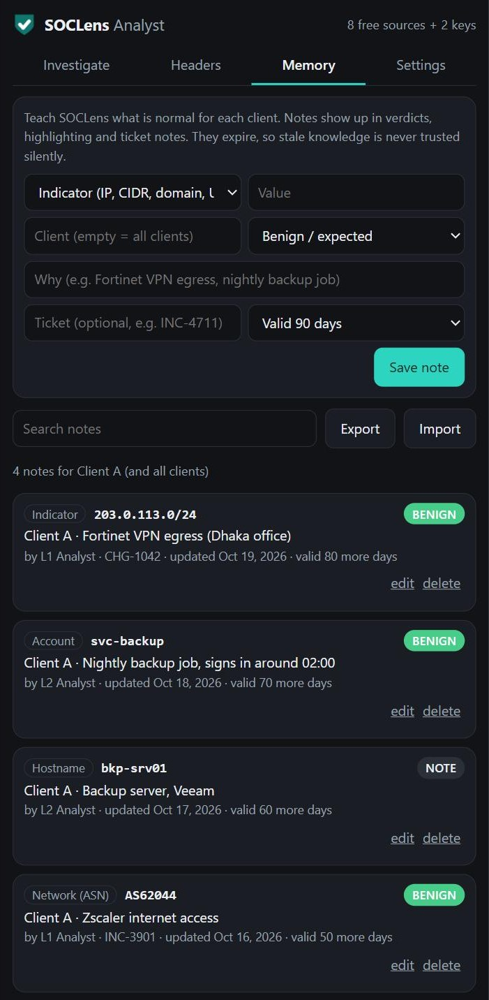
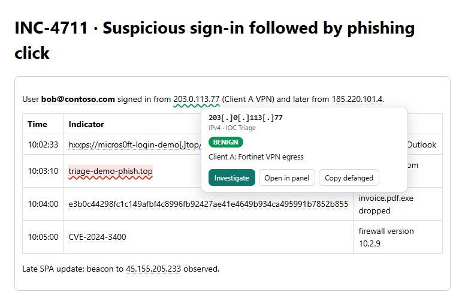

# SOCLens: SOC analyst assistant & phishing protection

**Select any IP, domain, URL, hash or CVE → right-click → Investigate.** One verdict from up to 15 intel sources, in plain words, with what to do next. Then copy a ready ticket note.

Free, open source, privacy-first. A Chrome / Edge extension (Manifest V3) by OpsVantage. No account, no server: everything runs in your browser, and intel lookups send only the indicator. No frameworks, no build step, about 250 KB.

[](LICENSE) [](https://github.com/kazisohan-cyber/soclens/releases) [](https://kazisohan-cyber.github.io/soclens/)

<p align="center">
  
  
  
</p>

## Install (1 minute)

1. Download `soclens-extension-v*.zip` from the [latest release](https://github.com/kazisohan-cyber/soclens/releases/latest) and unzip it.
2. Open `chrome://extensions` (or `edge://extensions`) → turn on **Developer mode** → **Load unpacked** → pick the unzipped folder.
3. Select any indicator on a page → right-click → **SOCLens: Investigate**. Optional: add free VirusTotal / AbuseIPDB keys in the panel's setup card (2 minutes) for known-bad verdicts.

## Screenshots

| | |
|---|---|
| <br>**Paste a whole alert.** Every indicator is checked; client memory adds context (accounts, hosts, VPN ranges). | <br>**Explainable verdicts.** Reasons, the sources behind them, and next steps for URLs, hashes and CVEs. |
| <br>**Email header analysis, on the device.** SPF / DKIM / DMARC, BEC patterns, delivery path. | <br>**Client memory.** What is normal per client, with owner, ticket and expiry. |
| <br>**Phishing protection + health.** Blocks fake logins, says what needs attention. | <br>**IOC highlighting on SOC consoles.** Coloured by client memory and past verdicts; click for a verdict. |

<sub>Screenshots use sample data: documentation IP ranges (RFC 5737), `.example` / demo domains, the EICAR test file and public CVE data. Reproduce them with `tests/analyst-preview.html?demo=1`.</sub>

## What it does

| Layer | What happens | Where |
|---|---|---|
| **Navigation guard** | Every URL is scored before it loads: brand lookalikes (`rnicrosoft`, `paypa1`), homoglyph/punycode domains (`аpple.com`), brand names on domains the brand doesn't own, real brand domains used as a prefix (`login.microsoftonline.com.evil.top`), free-hosting abuse, raw IPs, `@` tricks, risky TLDs, org blocklist. Dangerous → full-page block. | `background.js` + `lib/analyzer.js` |
| **Fake login detection** | On pages with a password field, checks if the page *looks like* Microsoft/Google/bank etc. (title, logo, favicon) but isn't on their domain. Adds domain age (RDAP) for already-suspicious sites. | `content/page-guard.js` |
| **Credential guard** | Learns the work password as a **salted PBKDF2 hash** when the user signs in on a corporate login page. If that password is typed anywhere else, the field is cleared *before* submit, the page is locked, and the SOC is alerted. | `content/page-guard.js` + `background.js` |
| **Email scanner** | Gmail + Outlook on the web: sender spoofing, display-name tricks, lure language, risky attachments, link-text vs real-destination mismatch, unwraps Google / Safe Links / Proofpoint redirects. Phishing → red banner, dangerous links **disabled** (can't be opened from the email). | `content/webmail.js` |
| **SOC reporting** | Every block / warning / bypass / user report becomes an event. With a backend configured, events are batched to it and an org-wide blocklist is pulled every 15 min. | `background.js` |

**Privacy:** email bodies and typed passwords never leave the browser. SOC events contain URL, host, reasons, and for emails only sender / subject / defanged links.

## SOC analyst assistant

An independent analyst toolkit inside the same extension. You don't need a server or an account: install it and it works.

| Feature | What it does | Where |
|---|---|---|
| **Right-click → Investigate** | Select any text (or right-click a link) on any page → the side panel extracts every IP, domain, URL, hash, email and CVE (defanged input is fine) and checks them all in parallel. Each indicator gets a **verdict, confidence, plain-English reasons, and what to do next**. | `background.js`, `pages/analyst.*`, `lib/sources.js`, `lib/engine.js` |
| **IOC highlighting** | On analyst sites (Securonix, HaloPSA, SentinelOne, Defender, Azure... editable), indicators are underlined: red malicious, orange suspicious, green known-good, blue client note, grey internal. Click one for a popover verdict. It uses the CSS Highlight API, so the SOC console's DOM is never modified, and no lookup runs until you click. | `content/ioc-highlight.js` |
| **One-click ticket note** | Copies a formatted note into HaloPSA or any ticket, as HTML with formatting kept, plain text, or Markdown. The note has the overall verdict, a per-indicator verdict with key findings, recommended actions, which sources were and weren't checked, and defanged indicators. | `lib/engine.js` `ticketNote()` |
| **Safe detonation + header analyzer** | Detonation scans a URL in urlscan.io (unlisted) and shows a screenshot, the final page, server, brands targeted and the verdict; your browser never opens the page. The header analyzer runs **fully on the device** on pasted headers: SPF/DKIM/DMARC, delivery path with hop delays, originating IP, Reply-To / display-name / brand mismatches (BEC patterns), spam verdicts, and one click to investigate the IOCs it finds. | `lib/sources.js` `detonate()`, `lib/headers.js` |
| **Client memory** | Teach SOCLens what is normal per client: indicators (IP, CIDR, domain incl. subdomains, URL, email, hash), **networks (ASN)**, **countries**, **accounts** and **hostnames**. Pick the **active client** at the top of the panel, and only that client's notes (plus all-client notes) are used. Every note records who, when and which ticket, and **expires** (default 90 days) so stale knowledge is never trusted silently. Exact-indicator notes weigh most, ASN less, country only lowers suspicion; strong public intel overrides a "benign" note and is flagged. Accounts and hostnames found in pasted alert text appear as **client context**, also in the ticket note. Export or import as JSON to share across the team. | `lib/memory.js`, `lib/sources.js` |
| **EDR import (SentinelOne)** | Memory tab → **Import from your EDR** → pick a SentinelOne **Threats**, **Endpoints** or **Data Lake** CSV export. Hashes the client already triaged become notes (false positive → benign, true positive → malicious, repeats merged); endpoints become hostname notes (OS, domain, last user) with their egress IP and internal IPs mapped to the hostname. You review and tick categories before anything is saved; re-importing a newer export updates notes instead of duplicating them. The file is read only in the browser. | `lib/importers.js` |

**Intel sources.** These need no key: GreyNoise community, Shodan InternetDB, ipinfo, RDAP (domain age), DNS (Cloudflare DoH), CISA KEV, FIRST EPSS, NVD, SOCLens lookalike/brand analysis, and the SOCLens phishing feed (when connected to a console). Free key, set in panel → Settings: VirusTotal (free tier 4/min: extra lookups queue and fill in automatically), AbuseIPDB, abuse.ch (URLhaus, ThreatFox, MalwareBazaar), urlscan.io. Keys are stored only in the browser. Requests go straight from the browser to each source with **only the indicator**, never page content. Results are cached (6–24 h) to save quotas. If the browser has a built-in on-device model (Chrome Prompt API), the panel adds a short AI summary drawn only from the evidence. Without one, SOCLens' own reasoning writes the summary.

The verdict logic is in `lib/engine.js` (`assess()`): weighted signals → malicious / suspicious / benign / unknown / internal, plus confidence from how many independent sources agree. CVEs get a priority instead (critical if in CISA KEV). Well-known infrastructure (public DNS resolvers, Google), Tor exits, hosting networks, new domains, lookalikes and free-webmail senders are recognised without any key.

## Run it (development)

1. Open `chrome://extensions` (or `edge://extensions`) → enable **Developer mode**.
2. **Load unpacked** → select the `extension/` folder.
3. Sign in once at `login.microsoftonline.com` so credential guard learns the password (popup shows "Active").
4. Analyst tools: right-click any selected text → **SOCLens: Investigate**, or toolbar popup → **Analyst panel**.

Tests: serve this folder (`python -m http.server 8765`) and open:
- `http://localhost:8765/tests/analyzer.test.html`: 58 analyzer cases.
- `tests/analyst.test.html`: 102 cases for the IOC parser, verdict engine, client memory, EDR import, ticket notes, header analyzer and activity list.
- `tests/mock-webmail.html`: email UI.
- `tests/analyst-preview.html`: the real side panel against the live free APIs (GreyNoise and CISA KEV are blocked by CORS on localhost only). Add `?demo=1` for the sample data used in the screenshots.
- `tests/highlight-preview.html`: IOC highlighting on a fake SOC console.

## Settings / admin policy

Everything in **Settings** can be pushed by the admin through browser policy (`managed_schema.json`). Policy-set values are locked in the UI.

| Key | Type | Purpose |
|---|---|---|
| `apiEndpoint`, `apiKey`, `tenantId`, `userId` | string | SOC backend + tenant/user tagging |
| `communityEndpoint` | string | Optional self-enrolling community console (https). **Empty by default: no server is built in**, so a fresh install never contacts any server. |
| `corporateDomains` | list | Org's own domains — always trusted |
| `corporateLoginDomains` | list | Where the work password is learned (add ADFS / Okta / VPN portal) |
| `allowedDomains`, `blockedDomains` | list | Org allow / block lists |
| `extraBrands` | list of `{name, domains, keywords, pageTerms}` | Protect the client's own brand from impersonation |
| `warnThreshold`, `blockThreshold` | int | Default 40 / 70 |
| `credentialGuard`, `webmailScanner`, `pageScanner`, `domainAgeLookup`, `allowUserBypass` | bool | Feature switches |

### Force-install + configure on Windows (GPO / Intune)

Replace `<ID>` with the extension ID (shown on `chrome://extensions` once published).

```reg
Windows Registry Editor Version 5.00

; Chrome — force install from Chrome Web Store
[HKEY_LOCAL_MACHINE\SOFTWARE\Policies\Google\Chrome\ExtensionInstallForcelist]
"1"="<ID>;https://clients2.google.com/service/update2/crx"

; Chrome — per-tenant config
[HKEY_LOCAL_MACHINE\SOFTWARE\Policies\Google\Chrome\3rdparty\extensions\<ID>\policy]
"apiEndpoint"="https://shield.example.com"
"apiKey"="<tenant-key>"
"tenantId"="client-a"
"allowUserBypass"=dword:00000000

[HKEY_LOCAL_MACHINE\SOFTWARE\Policies\Google\Chrome\3rdparty\extensions\<ID>\policy\corporateDomains]
"1"="clienta.com"
"2"="clienta.com.my"

; Edge — same idea
[HKEY_LOCAL_MACHINE\SOFTWARE\Policies\Microsoft\Edge\ExtensionInstallForcelist]
"1"="<ID>;https://edge.microsoft.com/extensionwebstorebase/v1/crx"
[HKEY_LOCAL_MACHINE\SOFTWARE\Policies\Microsoft\Edge\3rdparty\extensions\<ID>\policy]
"tenantId"="client-a"
```

Intune: use the Settings Catalog (Chrome / Edge → Extensions) for the force-install list, and a custom ADMX-backed / registry (Win32 or remediation script) profile for the `3rdparty` keys.

## Backend API contract (for the VPS)

All requests carry `Authorization: Bearer <apiKey>` and `X-SOCLens-Tenant: <tenantId>`. HTTPS only.

`POST /v1/events` → `{ "events": [ Event, ... ] }` (≤ 50 per batch, retried until 2xx)

```json
{
  "id": "uuid", "ts": "2026-10-19T08:00:00Z", "type": "credential_reuse_blocked",
  "severity": "critical", "url": "https://...", "urlDefanged": "hxxps://...", "host": "evil.example",
  "score": 90, "reasons": ["..."], "brand": "Microsoft",
  "email": { "sender": "...", "senderName": "...", "subject": "...", "client": "gmail" },
  "links": [{ "url": "hxxps://...", "score": 80 }],
  "tenantId": "client-a", "userId": "user@clienta.com", "installId": "uuid", "version": "0.1.0", "ua": "..."
}
```

Event types: `url_blocked`, `page_blocked`, `page_warned`, `credential_reuse_blocked`, `phishing_email_detected`, `user_report_site`, `user_report_email`, `user_bypass`, `user_trusted_site`.

`GET /v1/blocklist` → `{ "domains": ["evil.example", "..."] }` — merged into the block list on every device within 15 min.

## Publishing

- **Chrome Web Store**: one-time developer fee; publish **Unlisted** for pilots. Needs a privacy policy URL; `<all_urls>` triggers in-depth review.
- **Edge Add-ons**: free, same package.
- Zip the *contents* of `extension/` (manifest at the zip root).

## Known limits

- Desktop Outlook / mobile mail apps are not scanned (only the link at click time, via the navigation guard).
- Gmail / Outlook DOM selectors can change; `content/webmail.js → bodies()/extract()` is the one place to update.
- Heuristics, not a threat-intel feed: pair with the SOC blocklist endpoint for known-bad domains.

## License

- `extension/`: [Apache License 2.0](extension/LICENSE) (also the repository default, [LICENSE](LICENSE))
- `console/`: [GNU AGPL v3](console/LICENSE). You can self-host and modify it; if you offer a modified console as a service, publish your changes.

See also [PRIVACY.md](PRIVACY.md) and [SECURITY.md](SECURITY.md).
